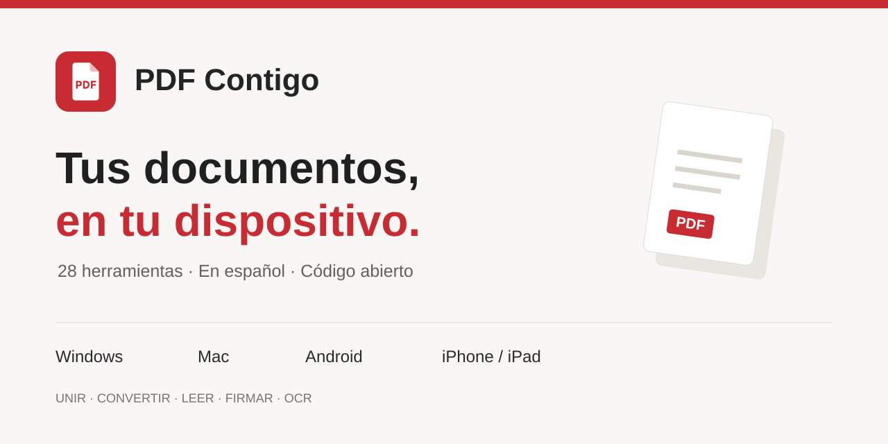

> **PDF Contigo 2.4.0-beta.10 · API recordada en tu dispositivo e informes más útiles.** Word editable con tablas sencillas, modo visual, Office a PDF con LibreOffice en escritorio y resúmenes con tu API de Gemini, OpenAI, Claude, Grok, Mistral o DeepSeek. [Guía de IA y conversiones](docs/IA-Y-OFFICE.md). Continúa siendo beta. Actions permanece pausado; las correcciones se preparan localmente, sin compilaciones de GitHub.

<p align="center"></p>

# PDF Contigo

**29 herramientas PDF en español y código abierto. Procesamiento local e IA opcional con tu API.** Para unir documentos, leerlos, convertir imágenes, poner una marca de agua, rellenar formularios y resolver tareas cotidianas sin enviar el archivo a un servicio de conversión.

**[Abrir PDF Contigo en la web](https://snipe-pdf.snipex.chatgpt.site)** · **[Descargar paquetes](https://github.com/joinsnipe/PDF/releases)** · **[Guía de instalación](docs/INSTALACION.md)**

Interfaz blanca y roja, texto claro y herramientas locales sin cuenta. La IA opcional requiere una cuenta de API externa y puede generar consumo. El código propio usa MIT; los componentes conservan sus licencias, incluido AutoScript bajo GPL-2.0. El proyecto nació para ayudar a una persona de la familia con sus documentos y se comparte para que cualquiera pueda utilizarlo y mejorarlo.

> **Web actualizada a 2.4 beta 8.** El enlace «Abrir PDF en la web» sirve también para Android e iPhone. Si tienes una pestaña antigua, recárgala y comprueba la etiqueta de versión. AutoFirma se integra únicamente en Windows y Mac; las instalaciones locales se actualizan con el ZIP nuevo.

## Elige tu dispositivo

| Dispositivo | Cómo utilizarlo | Sin conexión |
| --- | --- | --- |
| Windows 10/11 x64 | Extrae todo, abre `Instalar_PDF.cmd` una vez y usa el icono PDF | Sí, con el paquete local |
| Mac con Apple Silicon | ZIP `macos-arm64`, extrae todo y abre `PDF.command` | Sí, con el paquete local |
| Mac con Intel | ZIP `macos-x64`, extrae todo y abre `PDF.command` | Sí, con el paquete local |
| Android | Web en Chrome → **Instalar PDF Contigo** o **Añadir a pantalla de inicio** | Necesita conexión para abrir |
| iPhone / iPad | Web en Safari → **Compartir → Añadir a pantalla de inicio** | Necesita conexión para abrir |

Mac: macOS 13.5 o posterior y navegador actualizado. Los paquetes de escritorio abren una aplicación web local e incluyen su runtime. No necesitas instalar Python o Node. Android e iOS utilizan la app web: no se distribuye APK, IPA ni aplicación de tienda. [Pasos y solución de problemas](docs/INSTALACION.md).

## Independencia de ChatGPT

Los ZIP de Windows y Mac incluyen la aplicación y sus motores: las herramientas PDF habituales funcionan en tu equipo sin cuenta, suscripción a ChatGPT ni alojamiento de PDF Contigo. Conserva una copia del ZIP. AutoFirma y LibreOffice requieren sus instalaciones respectivas; la IA externa requiere Internet y la cuenta del proveedor.

La web pública sí depende de su alojamiento, y el acceso instalado en Android/iPhone sigue siendo esa web. El proyecto no garantiza alojamiento perpetuo ni su continuidad al cambiar un plan de ChatGPT. El ZIP `web` puede alojarse en un servicio estático HTTPS que tú controles; no necesita el servidor de IA de PDF Contigo. [Opciones técnicas](docs/DESARROLLO.md).

## Configura la IA sin complicaciones

Pulsa **Configurar IA** en la parte superior, elige el proveedor donde creaste la clave, pégala y pulsa **Conectar con ese proveedor**. No hay proveedor preseleccionado. Si corriges la selección, la clave permanece en el campo: el aviso indica si su formato parece de otro proveedor, sin enviarla automáticamente. La app elige un modelo de texto automáticamente; el cambio manual está en **Opciones avanzadas**. Después pulsa **Entender mi PDF**: recibirás un resumen y, cuando consten, peticiones, documentación y fechas en un único informe. El indicador verde **IA conectada** muestra el proveedor de esta pestaña. Para cada documento, pulsa **Revisar texto** y después **Enviar a tu proveedor y analizar**. Este segundo clic confirma el envío; ya no hay una casilla de autorización. La configuración manual aparece en ámbar porque aún no se ha comprobado.

**¿No tienes API?** La configuración incluye enlaces y pasos para obtenerla. Gemini ofrece cuota gratuita para ciertos modelos y cuentas; comprueba tu plan en Google AI Studio. No se garantiza uso gratuito con cualquier clave o modelo. También puedes elegir **Resumen gratuito sin API**, que selecciona frases localmente y no utiliza IA.

Puedes elegir **Recordar mi conexión en este dispositivo**. La API y el modelo se guardan cifrados y se desbloquean con una contraseña de PDF Contigo, sin volver a copiar la clave. Cada perfil conserva su propia conexión; no hay sincronización ni servidor de claves. En escritorio la copia sobrevive al cambio de puerto y a la actualización del paquete. Si no lo activas, la clave se conserva solo durante la sesión. [Guía y condiciones](docs/IA-Y-OFFICE.md).

**Tu dispositivo → tu proveedor.** La web conecta directamente con la API elegida. En Windows/Mac, el conector se ejecuta en tu propio ordenador y contacta con ese proveedor por HTTPS. Las consultas no pasan por un servidor compartido de PDF Contigo. En web/móvil, la conexión depende de que el proveedor permita acceso desde el navegador; si lo bloquea, utiliza el paquete de escritorio. No se recurre a un proxy externo automáticamente.

## Accesibilidad y lectura cómoda

Abre **Accesibilidad · lectura cómoda**, debajo del título, para activar texto más grande, más contraste o reducir movimiento. Se recuerdan solo estas preferencias visuales en tu navegador. Se refuerza el foco del teclado y el enlace para saltar al contenido. El visor ofrece **Texto de esta página**, ampliable y navegable con teclado; los escaneados requieren OCR.

Son mejoras prácticas de acceso a la interfaz, no una certificación WCAG ni una conversión automática de documentos a PDF accesible. [Alcance y comprobaciones](docs/ACCESIBILIDAD.md).

## Trabaja viendo tus páginas

Selecciona páginas tocando sus miniaturas. En «Girar PDF» ves el giro antes de guardar. Al terminar, revisa el PDF generado en un visor con zoom y búsqueda. Las miniaturas se cargan de doce en doce. [Qué muestra cada una de las 29 herramientas](docs/UX.md).

## Qué puedes hacer

| Área | Herramientas |
| --- | --- |
| Páginas | Unir, dividir, organizar, girar, numerar, recortar, cambiar tamaño |
| Convertir | JPG/PNG a PDF, PDF a imágenes, extraer texto, Word editable o visual, Office a PDF en escritorio, escala de grises |
| Editar | Comprimir, marca de agua, añadir texto, ocultar una zona |
| Firma y seguridad | Firma a mano (imagen sin certificado), contraseña AES-256, desbloquear con contraseña conocida, firma digital con AutoFirma o P12/PFX, limpiar metadatos, reparar |
| Formularios | Rellenar AcroForm y aplanar campos |
| Leer | Visor con búsqueda y zoom, OCR español/inglés, resumen local o con IA, comparar texto |

**Firmar con certificado:** abre **Firmar con certificado**, añade el PDF y deja seleccionado **AutoFirma** en Windows o Mac. Elige **Permitir otras firmas** o **Certificar sin cambios** (solo como primera firma). Confirma que quieres firmar y pulsa **Firmar con AutoFirma**. Elige el certificado y, si quieres marca visible, su página y zona en AutoFirma. Vuelve a PDF para guardar el resultado. No tienes que exportar el certificado ni introducir aquí la contraseña del P12. [Instalación y solución de problemas](docs/AUTOFIRMA.md).

**PDF con contraseña:** entra en **Visor de PDF**, selecciona el archivo e introduce su contraseña. Se abre el resultado y puedes guardar una copia sin contraseña. Si contiene firmas digitales, se bloquea esta conversión para conservarlas; abre el original con un lector compatible. Esto se aplica al archivo PDF; primero tienes que descargarlo desde la web de la administración.

**Descargar:** usa **Descargar**, **Guardar como…**, **Abrir resultado** o **Compartir archivo…**, según lo que admita el navegador. En iPhone, Compartir permite elegir **Guardar en Archivos**. Los resultados múltiples se agrupan en ZIP y, hasta 30 archivos, también tienen enlaces individuales.

## Límites que conviene conocer

- Resumen local: frases literales. Resumen con IA: síntesis o explicación con citas por página, usando tu API de uno de los seis proveedores. Debes revisar y autorizar el texto; puede tener coste y equivocarse. Los escaneados necesitan OCR primero.
- PDF a Word ofrece texto y tablas sencillas editables, sin reconstruir imágenes ni garantizar el diseño. El modo aspecto inserta una imagen por página y no es editable. Hasta 80 páginas.
- La firma a mano es una imagen. La firma digital de escritorio usa AutoFirma (instalada por separado); el método P12/PFX RSA permanece como alternativa. PDF no configura sello de tiempo ni verifica confianza o revocación de la CA. La app bloquea cambios de contenido y seguridad en documentos firmados. «Certificar sin cambios» declara que no se permiten ediciones ni nuevas firmas; no impide físicamente alterar una copia, pero una modificación prohibida no conserva intacta la certificación.
- El recorte es visual. Para eliminar una zona utiliza la herramienta específica de ocultación y revisa el resultado; convierte las páginas en imágenes.
- Hasta 100 MB y 100 archivos por tarea, 500 páginas, OCR de 30 páginas y conversión a imágenes de 150 páginas. Los móviles pueden agotar memoria antes.
- Office a PDF admite DOCX, XLSX y PPTX en Windows/Mac con LibreOffice instalado aparte. Hasta 25 MB, sin contraseña, macros ni datos externos. No funciona como conversor Office local en web/móvil. No incluye PDF/A validado, PDF a Excel/PowerPoint ni edición del texto original.

Consulta el [detalle de las herramientas](docs/FUNCIONES.md) y la [política de privacidad](docs/PRIVACIDAD.md).

## Desarrollo

Requisitos: Node 24, npm, Python 3.10+ y OpenSSL para las pruebas de firma.

```bash
git clone https://github.com/joinsnipe/PDF.git
cd PDF
npm ci
npm ci --prefix hosting
npm run build
python -m pip install -r tests/requirements.txt
npm test
python -B -m unittest discover -s tests -p 'test_*.py'
python local/launcher.py
```

Si el ejecutable se llama `python3`, sustituye `python` por `python3`. El lanzador muestra una dirección local y abre el navegador. No abras `dist/index.html` directamente como archivo.

Los motores se reconstruyen con las versiones fijadas en `package-lock.json`: el repositorio contiene código y licencias; las Releases contienen la aplicación preparada. `npm run build:client` prepara PDF.js, pdf-lib, qpdf WASM, OCR, firma e iconos. `npm run build` prepara además el alojamiento web, sin relay de IA; requiere las dependencias de `hosting/`. [Arquitectura, empaquetado y despliegue](docs/DESARROLLO.md).

## Colaborar y compartir

Puedes utilizar, estudiar, modificar y redistribuir el código propio bajo la [licencia MIT](LICENSE). Las dependencias conservan sus [licencias y atribuciones](THIRD_PARTY_NOTICES.md). Puedes regalar los paquetes o compartir el enlace web.

Para informar de un fallo, abre una [issue](https://github.com/joinsnipe/PDF/issues) indicando sistema, navegador, herramienta y pasos. **No adjuntes documentos personales, contraseñas o certificados.** Utiliza un ejemplo ficticio. Consulta [CONTRIBUTING.md](CONTRIBUTING.md).

[Historial de cambios](CHANGELOG.md) · [Seguridad](SECURITY.md) · [Pruebas manuales pendientes](docs/VALIDACION.md)
